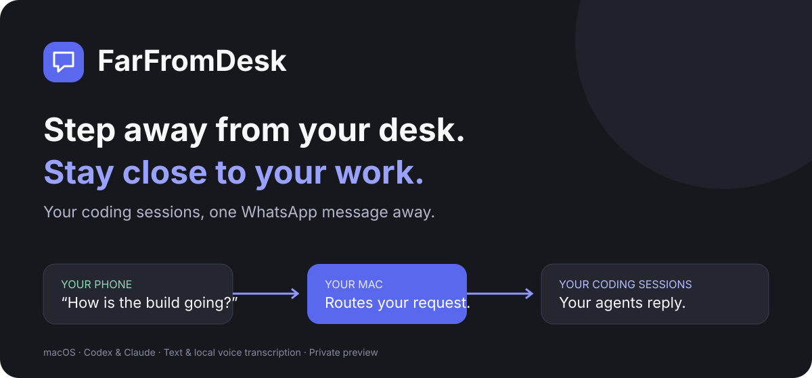
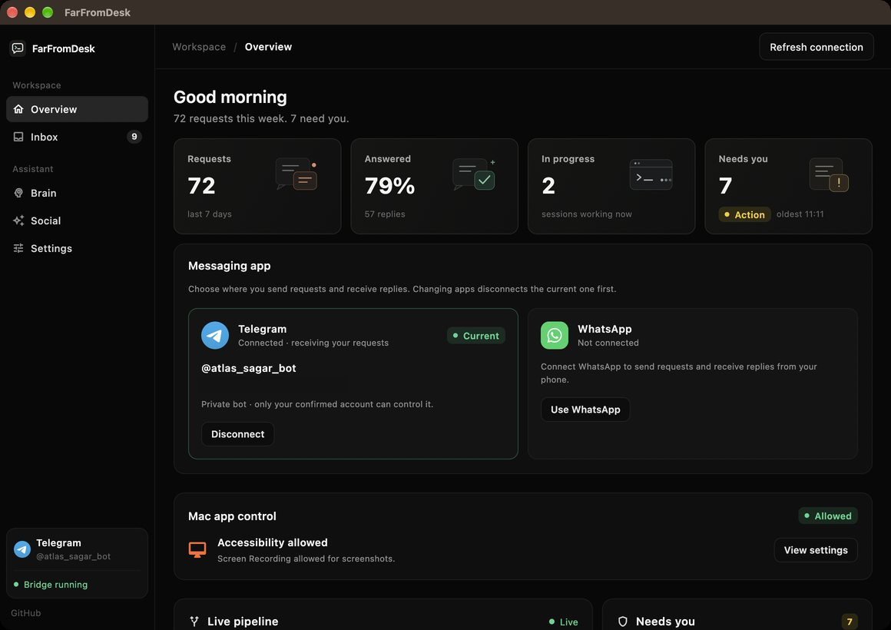
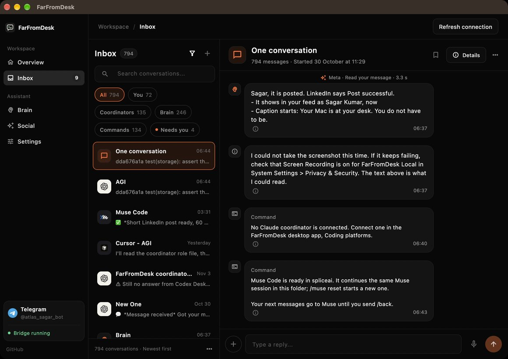
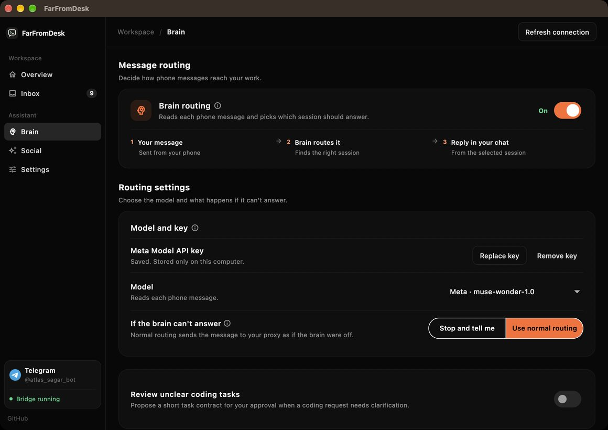
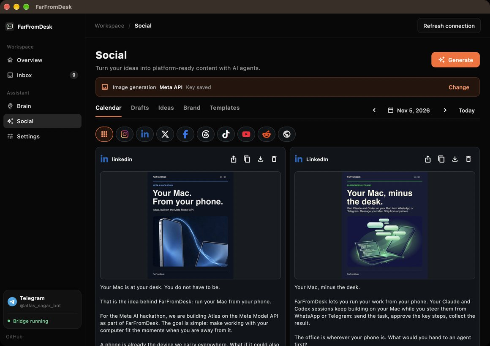
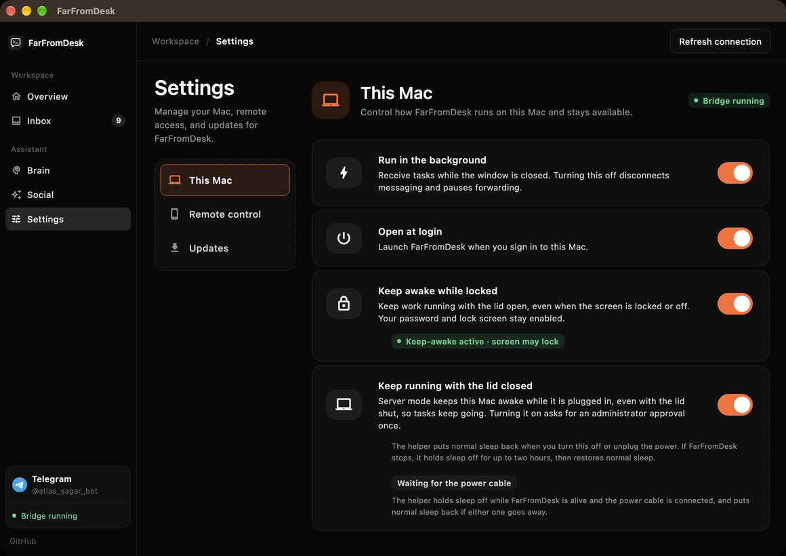

<p align="center">
  
</p>

<p align="center">
  <strong>Your Mac is at your desk. You do not have to be.</strong><br />
  Run your coding sessions, your Mac apps and your social posts from WhatsApp or Telegram.
</p>

<p align="center">
  <a href="https://github.com/LazyCodeer/farfromdesk/releases/latest"><strong>Download FarFromDesk</strong></a> ·
  <a href="https://farfromdesk.com">Website</a> ·
  <a href="#get-started">Get started</a> ·
  <a href="#what-you-can-do">Features</a> ·
  <a href="#questions">Questions</a>
</p>

> **Free to use right now** as part of the Meta Global AI Developer Hackathon. The Mac version is available today; Windows and Linux versions are coming soon.
>
> **Platforms:** The current stable version is tested on macOS only. Testing versions for Windows and Linux are being released as well.

FarFromDesk runs on your computer and links it to your own WhatsApp or Telegram chat. Send a message or a voice note from your phone, and **Atlas**, the FarFromDesk brain built on the **Meta Model API**, reads it and sends it to the right place: one of your Codex, Claude, Muse or Cursor sessions, a Mac app, your notes and calendar, or the Social page. Replies come back to the same chat.

## A look inside



<details>
<summary>Inbox, Brain, Social and Settings</summary>

**Inbox.** Every conversation in one thread, including what Atlas did on Meta and the commands you sent.



**Brain.** Turn on Atlas routing, add your Meta Model API key and pick a model.



**Social.** Drafts with generated images, ready to review and post.



**Settings.** Run in the background, keep awake while locked, and server mode for the lid closed.



</details>

## What you can do

| | |
| --- | --- |
| **Talk to Atlas** | Atlas, built on the Meta Model API, reads each message and picks which session or tool should handle it. It remembers what to call you and how you like replies. |
| **Switch coordinators** | Send `/codex`, `/claude`, `/muse` or `/cursor` to talk to that coordinator directly. Send `/back` to return to Atlas. |
| **Use WhatsApp or Telegram** | Pair your own WhatsApp account (message yourself) or a private Telegram bot. Only your confirmed account can control it. |
| **Create social posts** | The Social page turns an idea into platform-ready drafts with generated images. Posting always asks you to confirm first. |
| **Notes, calendar and reminders** | Read and add Apple Notes, check and add calendar events, and set one-time or repeating reminders by message. |
| **Drive Mac apps and browser tabs** | Open and use Mac apps and browser tabs, fill in forms and attach files, and get a screenshot back. |
| **Follow everything in the Inbox** | One thread shows your messages, session replies, commands and Meta activity, with filters for what needs you. |
| **Send a voice note** | Voice notes are transcribed on your computer and handled like text. |
| **Keep working when you step away** | Server mode keeps tasks running with the lid closed or the screen locked. |

## Get started

### 1. Download and open

Get the [latest release](https://github.com/LazyCodeer/farfromdesk/releases/latest).

| Your computer | Download | Status |
| --- | --- | --- |
| Mac with Apple Silicon | `macos-arm64.dmg` or `.zip` | Stable, macOS 14+ |
| Mac with Intel | `macos-x64.dmg` or `.zip` | Stable, macOS 14+ |
| Windows PC | `windows-x64-setup.exe` or `.zip` | Testing version |
| Linux PC | `linux-x64.tar.gz` | Testing version |

Drag **FarFromDesk.app** into Applications. Mac builds are ad-hoc signed and not notarized by Apple, so the first open may need **Open** from the right-click menu, or **Open Anyway** in System Settings, Privacy & Security. Only confirm this if you trust the download.

On macOS or Linux you can also install from your terminal. It verifies the archive checksum and installs for your user account:

```sh
curl -fsSL https://farfromdesk.com/install.sh | sh
```

### 2. Connect WhatsApp or Telegram

On **Overview**, choose a messaging app. For WhatsApp, scan the QR code from WhatsApp, Settings, Linked devices. For Telegram, create a bot with BotFather, enter its token and confirm your account. See [Telegram setup](docs/telegram.md).

### 3. Set up the brain

Open **Brain**. Enter your **Meta Model API key** first. Once the key is saved, the available models load and you pick one. Then turn on Brain routing.

### 4. Connect your coding sessions

Connect Codex, Claude, Muse or Cursor sessions you already use. Each keeps its own context, sign-in and permissions.

### 5. Send a message

> "Give me an update on the website redesign."

> "/claude fix the mobile navigation and send me the result."

> "Remind me at 6 PM to call the bank."

> "Draft a LinkedIn post about today's release with an image."

## Coordinator commands

| Command | What it does |
| --- | --- |
| `/codex` | Talk to your Codex coordinator. |
| `/claude` | Talk to your Claude coordinator. |
| `/muse` | Talk to Muse. |
| `/cursor` | Talk to Cursor. |
| `/back` | Leave the selected coordinator and return to Atlas. |
| `/help` | Show commands and the current target. |

If several sessions fit, Telegram shows buttons and WhatsApp shows a numbered list. See [owner commands](docs/owner-commands.md).

## Mac control

With Accessibility and Screen Recording allowed, Atlas can open Mac apps and browser tabs, read what is on screen, fill in forms, attach files and send you a screenshot. See [desktop control](docs/desktop-control.md).

**Server mode** (Settings, This Mac) keeps your Mac awake while it is plugged in, so tasks keep going with the lid closed or the screen locked. Your lock screen password stays on. Turning it on asks for administrator approval once. See [lock screen and remote control](docs/remote-control-lock-screen.md).

## Private by design

- Only your paired account and chosen chat can send requests.
- Keys are stored only on your computer.
- When Atlas is on, your message, recent conversation and the always-read memory files are sent to the Meta Model API. Keep passwords out of memory files.
- Your coding apps keep their normal permissions. FarFromDesk does not sandbox an app that already has broad file access.
- Social posts are never published without your confirmation.

FarFromDesk uses an unofficial WhatsApp connection and the official Telegram Bot API. It is not affiliated with WhatsApp, Telegram, Meta, Anthropic, OpenAI or Cursor.

## Questions

**Does my computer need to stay on?** Yes. FarFromDesk runs on your computer, so it must stay awake and online.

**Can I close the lid?** Yes, with server mode on and the power cable connected. On battery, or if the app stops, the Mac sleeps normally.

**Where do updates appear?** In [GitHub Releases](https://github.com/LazyCodeer/farfromdesk/releases). The app checks for new versions and shows **Update available**.

**Need help?** See [Troubleshooting](docs/TROUBLESHOOTING.md). Report security issues using [our security policy](SECURITY.md).

## License

FarFromDesk is licensed under the [GNU Affero General Public License v3.0](LICENSE) (AGPL-3.0). Copyright Codecy Labs (Sagar Kumar).

You can use, study and change FarFromDesk for free. If you distribute a modified version, or run one as a service for others, you must publish your changes under the same license. For a commercial license without these terms, contact Codecy Labs / Sagar Kumar. Third-party components keep their own licenses, listed in [THIRD_PARTY_NOTICES.md](THIRD_PARTY_NOTICES.md).
