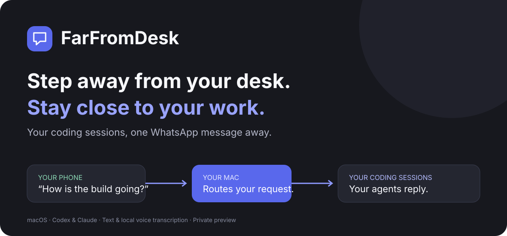
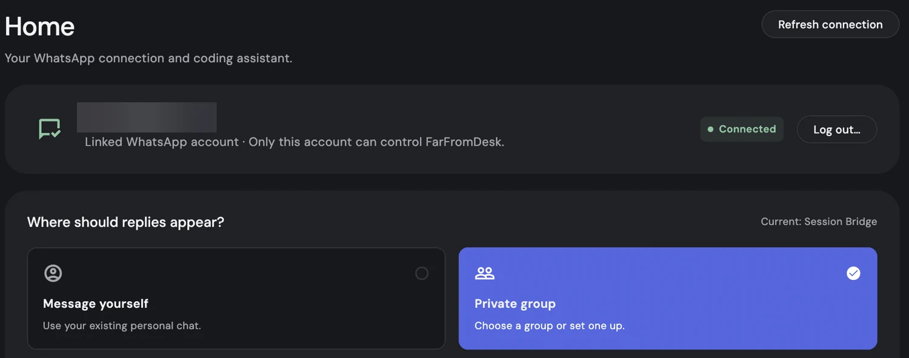
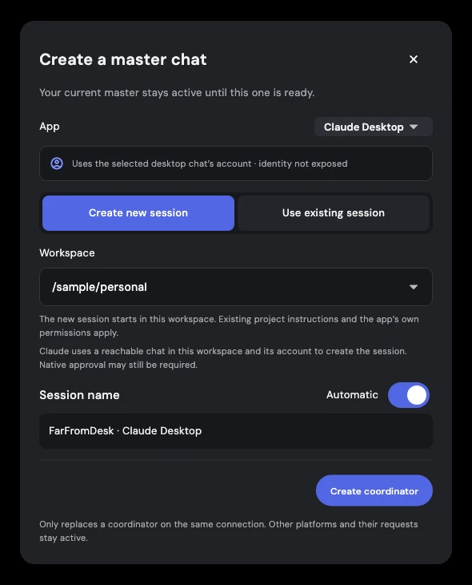
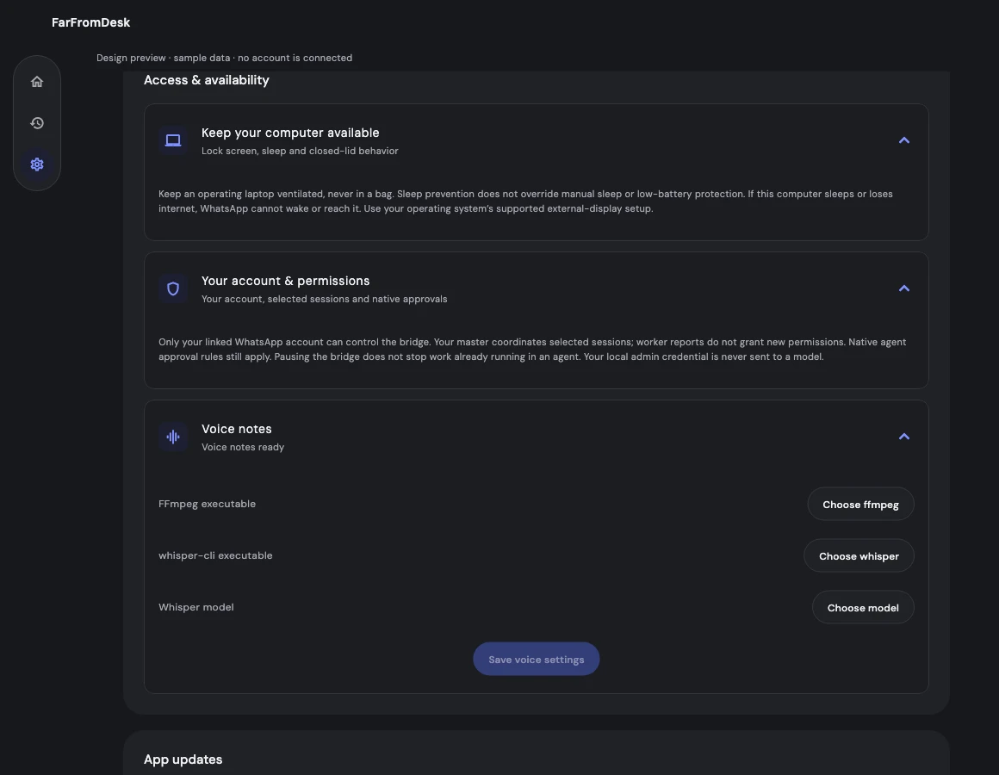

<p align="center">
  
</p>

<p align="center">
  <strong>Step away from your desk. Stay close to your work.</strong><br />
  Connect WhatsApp or Telegram to your coding assistants on your computer.
</p>

The next release adds an opt-in macOS desktop-control preview. See [desktop control](docs/desktop-control.md) for setup, reusable app/browser functions and tested limits.

<p align="center">
  <a href="https://github.com/LazyCodeer/farfromdesk/releases"><strong>Download FarFromDesk</strong></a> ·
  <a href="https://ffd.codecylabs.com">Website</a> ·
  <a href="#get-started-in-three-steps">Get started</a> ·
  <a href="#what-you-can-do">Features</a> ·
  <a href="#questions">Questions</a>
</p>

<p align="center"><strong>Open source · MIT</strong> · macOS · Windows · Linux</p>

Ask for updates, give your coding assistants instructions, and get their replies on your chosen messaging app. Your assistants keep their own context and tools. You choose which sessions to connect.

## A look inside

Connect your WhatsApp account and choose where replies appear. The phone number in this app screenshot is obscured.



<details>
<summary>Workspace setup and Settings</summary>

These previews use sample data from the current interface.





</details>

## Download FarFromDesk

Visit the [latest release](https://github.com/LazyCodeer/farfromdesk/releases/latest) and choose the download for your computer below. Mac ZIP and DMG files contain **FarFromDesk.app**. GitHub's automatic “Source code” downloads are for contributors, not the installed app.

| Your computer | Download | Requirements |
| --- | --- | --- |
| Mac with Apple Silicon | `macos-arm64.dmg` or `.zip` | macOS 14+ |
| Mac with Intel | `macos-x64.dmg` or `.zip` | macOS 14+ |
| Windows PC | `windows-x64-setup.exe` or portable `.zip` | Windows 10/11 x64; supported signed-in CLI |
| Linux PC | `linux-x64.tar.gz` | glibc 2.35+, GTK 3, desktop session; supported signed-in CLI |

On Mac, drag **FarFromDesk.app** from the DMG into Applications, or extract the ZIP. On Windows, run the **Setup EXE** for a per-user installation and Start menu shortcut. Windows and Linux archives contain the app and its bundled backend; extract the whole folder together. Each release includes optional installation scripts, checksums and release notes. Local voice tools are included. The multilingual voice model (141 MB) downloads once on the first voice note, or from Settings. Later voice notes work offline with the cached model.

**Signing:** Mac builds are ad-hoc signed and not Apple-notarized; Windows builds are unsigned. Your operating system may require explicit approval or block installation under organizational policy. Do not disable security protections. Downloads do not require a GitHub account.

Mac supports the existing Desktop integrations (which require Python 3) and CLI options. Windows and Linux currently support **Codex CLI and Claude CLI**; controlling their Desktop chats is not available. Native startup and voice checks run on all four build targets, but real-phone/provider account testing is still required on each operating system. ARM Windows/Linux and older Linux distributions are not supported by this release.

## Install from your terminal

On macOS or Linux, this downloads the latest version-pinned installer, verifies the app archive checksum, and installs for your user account:

```sh
curl -fsSL https://ffd.codecylabs.com/install.sh | sh
```

The terminal installer shows download progress, then verification, unpacking and installation stages.

On Windows, download **install.ps1** from the latest release and run it in PowerShell, or use the ZIP download. You can inspect either installer before running it. No administrator access is required. Pause forwarding and quit an older FarFromDesk before replacing it; your pairing and saved requests stay outside the app installation.

## Get started in three steps

### 1. Choose WhatsApp or Telegram

For WhatsApp, scan the QR code from **WhatsApp → Settings → Linked devices → Link a device**. Choose **Message yourself** or a supported private group containing only your account. For Telegram, create a dedicated bot with BotFather, enter its token locally, open the pairing link and confirm your account in FarFromDesk. [Telegram setup and limits](docs/telegram.md). Change messaging apps in Settings; switching disconnects the current account first.

### 2. Choose your assistant

Choose Codex or Claude and an available Desktop or CLI option. Connect an existing coordinating session or create one in a detected workspace. For Claude Desktop, FarFromDesk opens a prepared chat on your Mac. Confirm the folder and press Send; FarFromDesk waits for the session's verified acknowledgment before connecting it. Your app's normal sign-in, account limits, and permissions still apply.

### 3. Send a message

Ask FarFromDesk to show your sessions, select the ones you want, and send an instruction or voice note. Keep your computer awake, online, and your chosen coding apps available.

## Your work, a message away

> “Show my recent sessions.”

> “Give me an update on the website redesign.”

> “Ask that session to fix the mobile navigation.”

> “Send me the result when it's ready.”

These are example requests. FarFromDesk routes them to your selected assistants and brings their replies back to you.

## What you can do

| | |
| --- | --- |
| **Stay connected to multiple sessions** | Add another session without disconnecting the ones already selected. |
| **Find the right conversation** | Browse recent sessions, search by name, or ask for older ones. |
| **Send a voice note** | Supported recordings are transcribed on your computer and handled like text requests. |
| **Receive files and updates** | Get approved documents and progress from your selected assistants. |
| **Choose where replies go** | Use your personal WhatsApp chat or a supported owner-only private group. |
| **Stay in control** | Review supported permission requests and see unfinished work in Activity. |
| **Change your assistant** | Switch the coordinating session or platform from Home. |
| **Work while your screen is locked** | Optionally prevent idle sleep while keeping your computer locked. |

## How it works

**Your WhatsApp or Telegram → FarFromDesk on your computer → Your selected coding sessions → Replies on the original channel.**

FarFromDesk connects to the assistants you already use. It does not replace their subscriptions or account permissions. The selected coordinating session helps direct your requests to the right worker sessions.

## Works with your tools

On Mac, FarFromDesk has **Codex Desktop**, **Codex CLI**, **Claude Desktop**, and **Claude CLI** options. Windows and Linux currently offer the CLI options. Availability depends on your installed version, sign-in, account, and whether the selected session can be reached.

Each Desktop or CLI connection can have its own coordinator, with one default for new messages. New Claude Desktop chats use a prefilled native chat and require your Send action; FarFromDesk verifies the session before dispatching its task. Existing-chat messaging is separate from this creation step. Follow the app’s recovery guidance instead of repeatedly creating replacements.

A chat visible in history may need to be opened before FarFromDesk can connect. A Desktop login does not automatically sign you into the CLI. Not every version and account combination has completed a real-phone test.

## Private by design, with you in control

- Your linked account and selected destination control incoming requests.
- Voice notes can use the on-device model or your own Deepgram/AssemblyAI API key. Cloud transcription sends the audio to your selected provider; keys are stored locally in a restricted file. Optional fallback uses an already-downloaded local model. Messaging and coding assistants use their normal network services.
- Your assistants retain their normal permissions. FarFromDesk does not isolate an assistant that already has broad file access.
- Uncertain requests are held for review rather than automatically repeated.

FarFromDesk uses an unofficial WhatsApp connection and the official Telegram Bot API. Telegram bots are cloud chats, not end-to-end encrypted Secret Chats. FarFromDesk is not affiliated with WhatsApp, Telegram, Meta, Anthropic, or OpenAI. Changes to those services can affect compatibility.

## Questions

**Does my computer need to stay on?** Yes. FarFromDesk runs on your computer, so it must stay awake and connected for real-time control.

**Can I close the lid?** The awake option prevents idle sleep; it does not override every closed-lid condition. Supported external-display setups may keep the Mac available. It never removes your lock-screen password.

**What happens if the app closes during a request?** Request history is saved. Activity shows work that needs a reply or review. If a request may already have run, check its native conversation before retrying.

**Can I use more than one session?** Yes. Selecting a new session adds it to the connected set. Quote a reply to address that particular session.

**Where do updates appear?** New app downloads and release notes appear in [GitHub Releases](https://github.com/LazyCodeer/farfromdesk/releases). FarFromDesk checks for newer compatible releases automatically and shows **Update available** in the top-right bar. You can also check in Settings. On macOS, **Update and restart** downloads and verifies the compatible release, then replaces and relaunches the app when active work permits. Windows and Linux open the download for manual installation. Checks run on launch and at most every six hours; no model credentials are sent to GitHub.

**Need help?** See [Troubleshooting](docs/TROUBLESHOOTING.md). For a bug report, include your app version, platform, and sanitized steps. Never share pairing QR codes, credentials, or private recordings. Report sensitive issues using [our security policy](SECURITY.md).

## License

[MIT](LICENSE)

## Version 0.7.8 scope

This release adds Telegram, cloud voice options, simpler coordinator management and session-scoped FFD commands. Native permissions and Claude Desktop’s Send step remain required. Experimental browser/Accessibility control remains local-only and is not shipped in this release.
