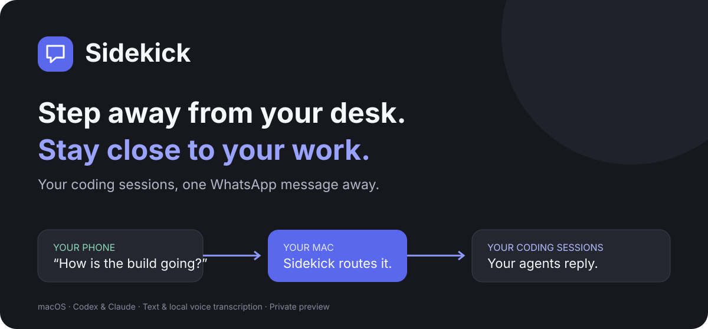
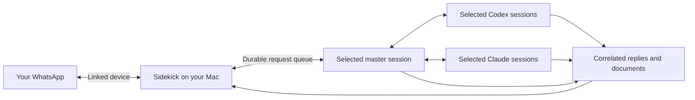

<p align="center">
  
</p>

<p align="center">
  <strong>Step away from your desk. Stay close to your work.</strong><br />
  A native Mac app that connects your WhatsApp to your coding assistants.
</p>

<p align="center">
  <a href="#get-started">Get started</a> ·
  <a href="#what-you-can-do">Features</a> ·
  <a href="#how-it-works">How it works</a> ·
  <a href="docs/reference.md">Technical guide</a> ·
  <a href="CONTRIBUTING.md">Contribute</a>
</p>

<p align="center"><strong>Private preview</strong> · macOS 14+ · Apple Silicon packaged build · Local voice transcription</p>

Sidekick lets you ask for updates, give your coding assistants instructions, and receive their replies from WhatsApp. Your agents keep their own context, tools, accounts, and permissions. You choose which sessions to connect.

> **Release status:** This repository is a private development preview. There is no public, notarized installer yet. Build instructions are available below. Compatibility depends on the installed coding app, account, and native transport. We do not claim that every provider/version has passed a real-phone end-to-end test.

## A conversation, not another dashboard

Illustrative examples of requests you can send after setup:

```text
You       Show my recent sessions.
You       Select 2 and 5.
You       Give me an update on the website redesign.
You       Ask that session to fix the mobile navigation.
You       Send me the result when it's ready.
```

Selecting another session adds it to the connected set. Your previous sessions stay connected. Replies retain their session identity, and you can quote a reply to address that session directly.

## Get started

Once the app is built and your chosen coding app is available:

### 1. Connect WhatsApp

Open Sidekick and scan the QR from **WhatsApp → Settings → Linked devices → Link a device**. Choose **Message yourself** or a supported private group containing only your own account.

### 2. Choose your coding assistant

Select Codex or Claude, choose Desktop or CLI, and connect an existing master session or create one. This session coordinates requests to your selected workers. Native folder approvals, account permissions, and app compatibility still apply.

### 3. Send a message

Send `/sessions`, select the sessions you want, and ask for an update or an action. Text and supported voice notes use the same permission boundaries. Keep your Mac awake, online, and the required native apps available.

For setup problems, see [Troubleshooting](docs/TROUBLESHOOTING.md).

## What you can do

| Capability | What it means |
| --- | --- |
| Multiple sessions | Connect multiple sessions on the same or different supported platforms. |
| Recent-session discovery | Browse five sessions per platform, ordered by native last activity; search names and load older results. |
| Desktop or CLI | Choose the integration that matches your installed app and account. |
| Your own WhatsApp chat | Use Message yourself or a supported owner-only group. |
| Voice requests | Decode and transcribe supported voice notes locally with FFmpeg and whisper.cpp. |
| Document replies | Prepare approved artifacts and send them through a session-scoped reply path. |
| Permission requests | Respond to supported native approval requests without turning every request into blanket access. |
| Durable request tracking | Inspect queued, submitted, completed, failed, and uncertain requests. |
| Change your master | Replace the coordinating session without manually clearing every old pending request. |
| Optional background operation | Keep the bridge running with explicit background and awake preferences. |

## Supported integrations

| Mode | Prerequisites and boundaries |
| --- | --- |
| Codex Desktop | Compatible installed Codex app and native queue support. Queue acceptance does not prove the agent executed the request. |
| Codex CLI | Authenticated, compatible Codex CLI/app-server runtime. Native approval policy remains active. |
| Claude Desktop | Compatible running Claude app and an exact, reachable local session inbox. Saved history can be listed without being currently reachable. |
| Claude CLI | Authenticated Claude Code CLI with an eligible account. A Desktop login is not automatically a CLI login. |

New Claude Desktop sessions require a selected reachable launcher and compatible native session creation support. Account limits or native folder consent can still prevent creation. Sidekick reports those conditions; it does not bypass them.

## How it works



The master decides how to coordinate your request. The selected coding agent performs the work under its existing permissions. Sidekick transports requests, approvals, and replies, while tracking their lifecycle.

Voice notes are downloaded to the Mac, converted into the format the local speech engine accepts, and transcribed locally. The transcript then enters the ordinary routing path. FFmpeg converts audio; whisper.cpp recognizes speech. The coding assistant may still use its own cloud model service.

## Privacy and permission boundaries

- Only the authenticated owner's allowed chat destination can initiate requests.
- Session-scoped credentials bind replies to registered sessions and request IDs.
- The management API listens on loopback and checks bearer credentials, hosts, and origins.
- The attachment flow stages approved artifacts rather than accepting arbitrary file paths from a remote request.
- Inbound deduplication and a durable outbox reduce duplicate dispatches and support recovery.
- Voice approval commands must be typed; transcription is not used to authorize an approval command.
- Sidekick preserves native permissions. It is **not** a sandbox for an agent that already has broad filesystem access.

WhatsApp transport uses the unofficial Baileys linked-device library. Sidekick is not affiliated with or endorsed by WhatsApp, Meta, Anthropic, or OpenAI. Service changes may affect compatibility. Review [SECURITY.md](SECURITY.md) before using it with sensitive projects.

## Build from source

### Requirements

- Apple Silicon Mac running macOS 14 or later for the bundled app/speech build.
- Xcode or Command Line Tools with a Swift 6 toolchain.
- Node.js **22.13+** and npm.
- Python **3.12+**, CMake, and the standard macOS build tools.
- A supported coding app/runtime, signed in with an eligible account.
- Internet access for initial dependency, speech source, and model downloads.

```sh
git clone https://github.com/LazyCodeer/sidekick.git
cd sidekick
npm ci
npm run check
npm test
./script/test_macos.sh
./script/build_and_run.sh --build-only
./script/install_macos.sh
```

Access to the private repository is required. Use `./script/install_macos.sh --replace` when updating an existing local installation. The installer backs up the previous app.

The app displays **Sidekick**. Its bundle filename remains `Session Bridge.app`, and its executable, service identifiers, and state directory retain their original names for migration compatibility. Existing pairings and stored requests are not renamed or discarded.

The build prepares pinned FFmpeg/whisper.cpp sources and a checksum-verified multilingual base model, then bundles them for local transcription. Model downloads occur during the build, not when you send a voice note. The current package is ad-hoc signed for local development, not Developer ID signed or notarized. Do not disable macOS security controls to run an untrusted build.

The app can initialize its bundled background service. Existing developer installations are reused. Advanced CLI setup and native hook installation are documented in [the technical guide](docs/reference.md).

## Development and verification

```sh
npm run check                 # TypeScript checks
npm test                      # Backend unit/integration suite
./script/test_macos.sh         # Native contract and UI-state tests
npm run build                 # Compile the bridge
```

The normal suite uses controlled fixtures. Local speech and live-service checks are explicitly opt-in; see [Testing](docs/TESTING.md). A green test suite is not proof that a phone message completed a real native action. Validate the chosen account, app version, hooks, delivery, and correlated reply before relying on remote control.

| Directory | Responsibility |
| --- | --- |
| `macos/` | SwiftUI app, platform discovery, setup and request UI |
| `src/` | WhatsApp transport, routing, queue, approvals, media and native adapters |
| `native/` | Vendored native desktop delivery helpers |
| `skills/` | Agent instructions for scoped replies and attachments |
| `test/` | Backend tests and synthetic audio fixture |
| `script/` | Build, install, packaging and diagnostic tools |
| `docs/` | Architecture, testing, troubleshooting and release guidance |

## Common questions

**Does this replace Claude or Codex?** No. It connects to your existing tools and accounts.

**Can I use it while my Mac is locked?** The optional awake setting prevents idle sleep while enabled. It does not remove the lock screen or override manual sleep, battery shutdown, or every closed-lid condition.

**Does my Mac need to stay on?** Yes. This is a local bridge. If the Mac or network is unavailable, real-time control is unavailable.

**What happens after a crash?** Durable state survives restarts. Ambiguous submissions are marked uncertain instead of being blindly replayed. Review the native chat before retrying an action that may have already happened.

**Is voice transcription offline?** Speech recognition runs on the Mac. WhatsApp delivery and cloud-backed coding assistants still require their normal network connections.

**Is this ready for public distribution?** Not yet. The [release checklist](docs/RELEASING.md) tracks signing, compatibility verification, licensing, and packaging work.

## Roadmap

Planned, not a promise of shipped functionality:

- Developer ID signed and notarized macOS releases.
- Published compatibility matrix backed by real-phone tests.
- Cleaner first-run readiness checks and recovery guidance.
- Measured startup, memory, and transcription performance across supported Macs.
- Additional provider adapters where a supported, permission-preserving path exists.

## Contributing and reporting issues

Start with [CONTRIBUTING.md](CONTRIBUTING.md). Useful reports include app/runtime versions, sanitized steps, expected behavior, and actual request state. Never attach account credentials, pairing QR codes, personal recordings, or complete state databases.

Use the repository's bug and feature templates for ordinary reports. Security issues follow the private process in [SECURITY.md](SECURITY.md).

## License and acknowledgments

Sidekick's first-party source is currently **all rights reserved** during private preview; an open-source license has not been selected. Third-party components retain their own licenses. See [LICENSE](LICENSE) and [THIRD_PARTY_NOTICES.md](THIRD_PARTY_NOTICES.md).

Built with SwiftUI, Node.js, Baileys, SQLite, whisper.cpp, and FFmpeg. UI fonts retain their bundled license notices. Thanks to the maintainers of those projects.
