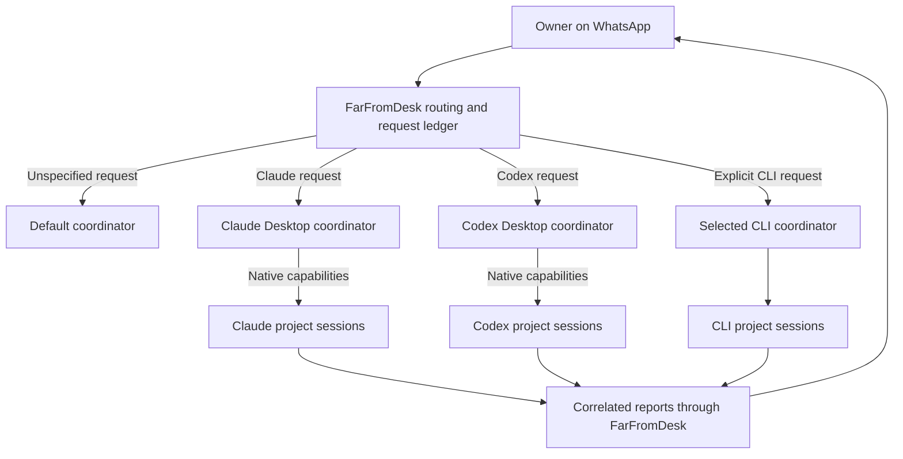

# FarFromDesk: per-platform coordinators and WhatsApp routing

Status: core implementation is installed locally as build 2022, 26 October 2026. No commit, push or public release has been performed for these changes.

## Implementation verification

- Implemented the persistent connection-scoped coordinator registry, default selection, request ownership, bounded correlated delegation, scoped catalogs and recovery, and coordinator setup UI. Default changes preserve existing requests. Desktop and CLI accounts remain separate.
- Backend suite: 249 passed, 2 optional tests skipped, zero failures. After the final account-scope and transactional migration changes, all 46 focused coordinator/setup/creation tests passed. Type checking and whitespace checks passed.
- Flutter: 18 tests passed; static analysis reported no issues.
- Live Claude probe: an honestly attributed relayed request produced a native proposal. After the owner clicked Start, the child acknowledged readiness and was verified detached and idle. No project task was dispatched. This verifies owner-started creation and detachment, not unattended creation.
- Setup now preserves the exact proposal/child identity, exposes needs-action and recovery, and permits one detach-only recovery without replaying creation. The original failed project creation operation remains untouched.
- Local installation: build 2022 passed an isolated packaged native startup test, then reconnected to WhatsApp with bundled voice ready. All 13 bindings, 9 pending requests and preferences were preserved; the legacy default migrated into the coordinator registry. A coherent private state backup and the previous app were retained before replacement. The unchanged native host/engine were reused; Flutter UI and backend were rebuilt.
- Remaining acceptance work: verify two-platform routing and replies through WhatsApp with the owner. Activity shows platform labels; full hierarchical request grouping and product-level automatic pre-migration backup/downgrade safeguards remain outstanding. Unattended Claude creation is not verified.

The sections below retain the approved target design; this status records what has actually been verified.

## 1. Intended experience

Connect the coding apps you use. Each selected connection gets one dedicated coordinator session, and you choose one default coordinator for general WhatsApp requests. A connection means provider + Desktop/CLI runtime + local profile + account scope where available. Claude Desktop and Claude CLI are separate connections; their accounts must never be assumed equal. The same applies to Codex.

Example configuration:

| Connection | Coordinator | Purpose |
| --- | --- | --- |
| Codex Desktop | FarFromDesk · Codex | Default for unspecified requests |
| Claude Desktop | FarFromDesk · Claude | Claude projects and sessions |
| Claude CLI, if explicitly selected | FarFromDesk · Claude CLI | CLI work under that CLI account |

Names are editable. Detection alone does not create coordinators or contact existing chats. The owner selects connections; setup creates a dedicated coordinator or lets the owner use an exact existing session. No additional launcher-session selector is needed after that coordinator is ready.

The owner can say:

- “Claude, check the payments session.”
- “Codex, create a session for the website.”
- “Show my recent Claude sessions.”
- “Continue this” while quoting a reply from a particular session.
- “Check the release” without a platform; this goes to the default coordinator.

FarFromDesk delivers explicit requests directly to their chosen coordinator. It does not require Codex to relay every Claude request. The default coordinator can coordinate a task spanning several platforms through the bridge, while the bridge preserves the original scope and request identity.

## 2. Evidence and the remaining live gate

| Capability | Current evidence | Implementation consequence |
| --- | --- | --- |
| Claude creates a local child with `start_session` | A real project child was verified | Use the native creation capability; do not substitute a CLI session |
| Claude accepts a canonical project path | Symlink path failed; real path succeeded | Resolve and display the real path before creation and approval |
| Claude can detach the child | Saved child metadata has `lineageDetached: true` | Independent project sessions can use create, detach, verify |
| Claude external inbox | Documented mechanism; an attributed investigation message was processed | Reuse verified transport, check compatibility, preserve inbound controls |
| Inbox-triggered unattended Claude creation | Not established; the successful example contained plain owner input as well as a child report | Required live test before advertising unattended creation |
| Inbox availability for every Claude chat | False; some processes have no registered inbox | Show exact capabilities and reopening state; never claim every listed chat is ready |
| Codex Desktop integration | Existing app implementation uses local history/native delivery | Retest through the new coordinator flow and installed build |

The earlier blanket conclusion that Claude cannot create these sessions was too broad. Conversely, the successful native example does not prove that an external inbox request can trigger creation without an owner action.

**First implementation gate:** send one honestly attributed owner-authorized test request to the selected Claude verification coordinator. It may initialize one disposable child in an approved test folder, only if the recipient's native rules allow it. Record receipt, actual tool/result, any proposal or permission prompt, exact child identity, detached state and child acknowledgment. Do not force `initiation: user_asked` against native rules, spoof a user turn, or retry uncertain submission.

If creation requires an owner action, existing-session messaging can still ship, but unattended Claude creation remains unavailable. Expose the exact native action, including a supported phone route where available. Remote Control configuration requires the owner's choice; it is not silently enabled. If the test succeeds, continue with the verified invocation and record the tested app version. This gate precedes a large UI implementation.

## 3. Architecture and ownership



The default is a pointer to one coordinator, not a unique privileged session or a mandatory intermediate hop. Each request records its responsible coordinator when accepted. A later default change affects new unspecified requests only.

Persist these concepts, using versioned storage and transactional updates:

- **Connection:** immutable identity, provider/runtime/profile/account reference, owner-facing label, observed capabilities and observation time. Unknown account identity is shown as unknown, not inferred from a neighboring CLI login.
- **Coordinator:** connection ID, exact binding/native session IDs, generation, name, role version and lifecycle state. One active coordinator per selected connection.
- **Defaults:** global default coordinator; optional preferred connection for a provider when both Desktop and CLI are selected.
- **Request:** root owner request ID, responsible coordinator and generation, frozen route, destination, status, children and reporting policy.
- **Delegation:** originating request, parent request, exact target connection/coordinator/worker, scoped task and stable event ID. It never creates a second independent owner request.
- **Creation operation:** operation ID, approved canonical project, connection, native/transport IDs, initialization nonce, completed stages and uncertainty information.

Proposed states:

- Coordinator: `not_configured`, `setting_up`, `needs_action`, `ready`, `offline`, `paused`, `failed`.
- Creation stages: `preflight`, `initialize`, `native_created`, `detach`, `verify`, `bind`, `dispatch`, `ready`.
- Failure outcome is separate from stage: `blocked` means no uncertain side effect; `uncertain` means an action may have happened and needs reconciliation.

Do not conflate app installed, chat discovered, inbox reachable, message acknowledged, and creation supported. Capability observations are versioned and revalidated after relevant app/account changes.

## 4. Routing rules

1. A verified quoted reply addresses its original session, scoped to the authorized WhatsApp destination. An explicit conflicting platform/session instruction asks for clarification rather than silently choosing.
2. An explicit command or unambiguous platform address chooses that selected connection's coordinator. “Claude CLI” and “Claude Desktop” are distinct. Mentioning Claude in explanatory text must not itself reroute a request.
3. “Claude” uses the owner's preferred Claude connection. If several match without a preference, show a small choice; never guess an account.
4. An exact connected session reference routes directly to it. Duplicate names produce matches with platform, project and recent activity.
5. Other requests go to the configured default coordinator. Unresolved natural-language routing is interpreted there, then submitted as a validated bridge routing/delegation operation.

An explicit destination being offline never sends work to the default instead. Display the actual state, preserve the request, and use a bounded queue or an owner-controlled resume. Reopen only the exact native identity through its supported adapter. No silent Desktop-to-CLI fallback.

The default can delegate a multi-platform task through the bridge. Each connection's coordinator manages workers on that connection. Cross-connection delegation is explicit in the request graph, with cycle detection, finite delegation depth and bounded fan-out. Worker reports cannot turn into fresh owner instructions or start autonomous coordinator reply loops.

## 5. Setup and session creation

### Coordinator setup

1. Select detected connections, with their runtime and account labels.
2. Choose a default. Create a dedicated coordinator or select an exact existing chat for each connection.
3. Complete native trust/login actions where required. Existing app login does not imply CLI login.
4. Install the versioned coordinator role and bridge reply instructions. Confirm an acknowledgment from the exact session before showing `ready`.

Claude bootstrap has a circular dependency if no coordinator or eligible launcher exists. The initial setup must use an owner-selected existing chat or a supported new-chat bootstrap. A deep link currently prefills a composer; it is not proof of automatic submission. Show any native action once and persist setup progress. Do not choose the newest unrelated chat behind the owner's back.

### New independent project session

1. Resolve the requested project to a real folder. For a new folder, resolve its existing parent and create only within the approved workspace. Verify path/account identity again before side effects; detect changed symlink targets or unavailable external volumes.
2. Persist the operation and scoped initialization brief. Use `context: fresh`; do not copy another project's transcript.
3. Ask the correct native coordinator to create the child using supported tools and its native permissions. The child initializes bridge instructions and waits; it does not start the user's task yet.
4. Persist the returned native ID immediately. For independent Claude project chats, detach that exact child, then verify the provider-reported detached state, real folder and identity. Do not edit Claude's metadata to fake detachment.
5. Confirm the child's reachable messaging identity and initialization acknowledgment. Native Desktop IDs and inbox UUIDs may differ.
6. Bind the child to the connection and bridge request graph. Native detachment removes native parent reporting; it does not remove FarFromDesk's stored request relationship.
7. Dispatch the actual task once, using a durable event ID. Existing sessions stay connected.

On a detach or binding failure, resume those stages for the same child. Never create another child merely because setup timed out. Reconcile an ambiguous detach through a native read-only query before retrying. No automatic task restart after detachment.

Selecting an existing project session skips creation and detachment. Reopen/validate its exact runtime, project and account, establish the bridge binding, and send the scoped task.

## 6. Permissions, recovery and replies

Replace global-master authorization with request-scoped checks. A valid coordinator token is necessary but insufficient: the coordinator must own the root request or have a recorded delegation. Server endpoints validate the calling binding, connection, request link, generation and allowed action. Workers cannot invoke coordinator-only operations. Permission remains enforced by each native app.

Keep attachments tied to the original destination and authorized request. Cross-platform handoff forwards only approved references and scoped instructions, not entire transcripts, credentials or another account's files.

Every consequential transition is durable before submission. Coalesce concurrent retries and use stable IDs. After restart:

- Safe preflight failures can retry the same operation.
- Confirmed children resume from their last incomplete stage.
- Ambiguous creation or task delivery stays uncertain until reconciled; it is never automatically replayed.
- Replacing one coordinator affects only that connection. Allow replacement even after failed setup, retain the error/recovery record, and close its old pending requests with an explicit replaced outcome under the owner's replacement action. Preserve active native work evidence; closing tracking does not prove native cancellation.
- Switching the default is not replacement and closes nothing.
- Delayed old-generation reports remain in history and cannot complete a new coordinator's request.

The bridge sends one initial acknowledgment per owner message. Worker/coordinator reports follow one reporting policy per root request, so the owner does not receive both the same worker answer and a repeated coordinator summary. Use a final summary for multi-platform work only when it adds useful combined results.

Default status check interval: ten minutes while work is active. Prefer native events; do not trigger a new model turn on every timer tick. Send substantive updates promptly, rate-limit repeated progress, and show an honest waiting status when a requested timed update has no new result. No nested-coordinator heartbeat multiplication. Stop updates when finished, cancelled or blocked pending owner action.

WhatsApp example:

```text
📨 *Claude Desktop · Payments review*
I’ll check that session and keep you updated.

— FarFromDesk
```

```text
✅ *Claude Desktop · Payments review*
The review is complete. I found two issues and saved the findings.

— FarFromDesk
```

Use the existing WhatsApp formatting conversion. Session/platform headings come from validated binding metadata. Do not repeat “Coordinator” in the footer or imply completion from a transport receipt.

## 7. UI changes

Retain the existing Home layout and theme. Replace the single-master controls with a compact **Coding platforms** section:

```text
Coding platforms                         Default: [Codex Desktop ▾]

Codex Desktop     Ready       FarFromDesk · Codex       [Manage]
Claude Desktop    Needs setup                          [Set up]
Claude CLI        Not selected                         [Connect]
```

Only selected connections need coordinators. Each Manage view offers rename, change coordinator, create replacement, pause/resume, account details and a native open action. Failed setup shows its error, Recover and Abandon without disabling Create replacement.

Show separate statuses for connection readiness and new-session capability. Use “Needs native action” with the concrete reason instead of a misleading global “Ready.” The Activity page groups the owner request with coordinator handoffs and workers, including destination platform, session, current stage, last verified update and available recovery action.

Session search defaults to five most recently active sessions per selected connection, with More, Previous and name search. Keep connection filters compact; cache catalogs and refresh on demand or relevant events rather than refetching on every navigation. Prevent a discovery timeout on one platform from freezing the other platform or app startup.

## 8. Implementation sequence and file ownership

| Phase | Work | Main code areas | Exit condition |
| --- | --- | --- | --- |
| 0 | Native feasibility probe and exact API evidence | Isolated test harness; native adapters | Honest Claude creation result, detach schema/result, child acknowledgment recorded |
| 1 | Coordinator registry, connection identity, defaults, migration | `store.ts`, `connections.ts`, proposed `coordinator-registry.ts` | Multiple coordinators persist; old master migrates once without side effects |
| 2 | Request ownership, routing, delegation, endpoint authorization | `coordinator.ts`, `router.ts`, `server.ts`, `master-channel.ts`, `cli.ts` | Two connections accept independent requests with no cross-route completion |
| 3 | Per-connection setup and durable creation/detach recovery | `masters.ts`, `workers.ts`, `desktop-start.ts`, `native.ts`, `session-activation.ts` | Exact child creation/recovery, no duplicate task execution |
| 4 | Coordinator roles and reply/progress policy | `master-policy.ts`, `roles.ts`, `coordinator-experience.ts`, request events | Versioned role once per required update; one receipt/report policy per request |
| 5 | Home setup and Activity UI | `desktop/lib/screens.dart`, related models/API client | All selected platforms manageable; failures do not block unrelated setup |
| 6 | Installed-app verification and release preparation | Integration tests, packaging scripts, docs | Phone-to-app acceptance suite passes for claimed capabilities |

Inspect all uses of `store.get('master')`, `master-operation`, singleton selection/browser state and current-master comparisons. In particular: `ownerRequest`, `resolveOwner`, report delivery, attachment forwarding, role installation, master endpoint authentication and replacement cleanup must use persisted request ownership rather than whichever coordinator is default now.

Do not blindly reuse `Connections.connectionProfile` as a unique account identity: it currently identifies provider/runtime/config-root, while account scope is separate. Preserve both and model unknown native identity explicitly. Future adapters can add providers only after declaring and verifying their capabilities.

## 9. Migration and rollout

- Preserve a consistent database snapshot and add a schema/version marker before migration. Do not bundle private state in a release.
- Register the existing active master as its connection's coordinator and global default. Preserve binding IDs, job IDs, destinations, selected workers and creation-operation IDs.
- Backfill historical request ownership from persisted jobs, not the current default alone. Unresolvable old operations remain inspectable and held.
- No automatic extra coordinators, login changes, task replay, detach actions or model calls during migration/startup.
- Feature-gate new routing until migration and authorization tests pass. After accepting multi-coordinator requests, an older binary must refuse incompatible state rather than silently route through one master.
- Keep the prior binary and snapshot for rollback. Rollback after new work requires quiescing and reconciling newer requests; restoring an old database alone could lose history or replay tasks.
- First validate the installed macOS app with Codex Desktop and Claude Desktop. Test CLI modes separately with valid CLI accounts. Windows/Linux retain their actual supported adapters; do not advertise Desktop parity from macOS tests.

## 10. Test and completion criteria

Use fake adapters, temporary stores and fake clocks for deterministic tests. Keep native integration tests opt-in and separate from the offline suite. Do not use real owner projects for destructive tests or rerun the original failed research request as a probe.

Required cases:

1. Two Desktop coordinators, one default; explicit platform routing and unspecified routing select the correct identities.
2. Default changes while work runs; results return to the original owner request and destination.
3. Claude Desktop signed in, CLI signed out; Desktop does not probe or execute through CLI credentials.
4. Same session UUID across runtimes and duplicate titles across projects/accounts; no accidental deduplication or wrong selection.
5. Quoted reply routing, conflicting explicit target, group versus self-chat destination and attachment authorization.
6. One coordinator offline, paused, held or missing an inbox; the other still works and no fallback occurs.
7. Per-coordinator access tests: another coordinator or worker cannot inspect, dispatch or resolve an unrelated request.
8. Cross-platform delegation, duplicate events, attempted cycles, delayed reports and independent progress timers.
9. New-session canonical path, changed symlink target, missing external volume, native trust prompt and unavailable creation capability.
10. Crash at every creation stage, including child-created-before-receipt, detach ambiguity and task-dispatched-before-ack. Recovery never creates a duplicate or replays uncertain work.
11. Child initialization before detachment, verified detached state, distinct native/inbox IDs and exactly one task dispatch.
12. Concurrent Create/Recover clicks, failed setup replacement and replacement of one coordinator while the other is busy.
13. Migration from the current single-master database, interrupted migration, incompatible downgrade and preserved historical errors.
14. Five-per-connection pagination, stable ordering for equal timestamps, name search, partial discovery failure and large catalogs.
15. Receipt/progress/final deduplication, role-version installation, native refusal and a blocked request that stops emitting updates.
16. No idle model-turn polling; bounded queues/caches. Measure bridge memory, CPU and discovery latency before/after with the same dataset. Report native app resource usage separately and investigate sustained post-idle growth.

Live acceptance: WhatsApp → selected coordinator → exact existing worker → verified reply; WhatsApp → supported creation path → initialized child → verified detach/binding → task → reply; simultaneous Codex/Claude work; one app closed/reopened; bridge restart with pending work; default switch during work. Record actual results and required native actions. A queued message, mock passing test or created session without task acknowledgment is not an end-to-end pass.

**Done means:** selected platforms each have a persistent coordinator; the default is optional routing preference rather than a global bottleneck; requests and replies retain exact ownership; supported creation/recovery does not duplicate work; the UI tells the truth about unavailable capabilities; and the installed app passes the relevant phone-driven acceptance checks. Unattended Claude creation is claimed only if its specific live gate passes.
